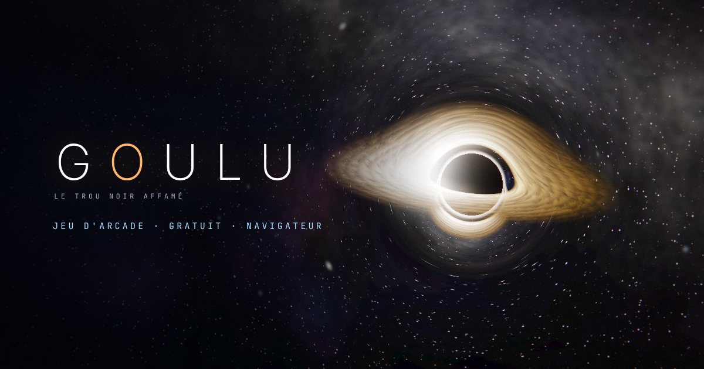

# GOULU — Le trou noir affamé



**[▶ Jouer maintenant](https://david2400749.github.io/goulu/)** · gratuit · sans installation · mobile et ordinateur

Tu es un trou noir. Tu as faim.

Deux commandes séparées :

| | **ASPIRER** (maintenir) | **ONDE** (appuyer) |
|---|---|---|
| Ordinateur | ESPACE ou clic gauche | F, Entrée ou clic droit |
| Téléphone | doigt posé n'importe où (repère en bas à gauche) | bouton ONDE en bas à droite |

- **Aspire** la poussière d'étoiles : elle recharge tes ondes.
- Lance l'**onde** pour détruire l'antimatière : **au dernier moment** pour un *parry*,
  **sur le battement** de la musique pour un *pulse*. Tu peux continuer d'aspirer pendant ce temps.
- L'ancien mode à un seul bouton (relâcher = onde) reste disponible dans les options.

Au programme : une campagne narrative en 10 chapitres, un défi du jour identique pour tous,
5 modes de jeu, des boss, des mutations à chaque vague, des skins et un arbre d'évolution permanent.
Partage ton score : le lien envoyé met tes amis au défi de le battre.

Le jeu s'installe comme une application depuis le navigateur (« Ajouter à l'écran d'accueil »).

---

## Développement

**Version actuelle : 0.13.0-dev, en développement.** Numérotation : `0.x.y` tant que le jeu est en
développement (suffixe `-dev` sur la branche de travail), `1.0.0` pour la première version officielle.
La version est définie dans `js/data.js` (`GAME_VERSION`, affichée dans le menu) et dans `package.json` ;
les tests vérifient que les deux sont identiques.

Ouvrir `index.html` dans un navigateur récent (WebGL2 recommandé ; sans WebGL2, un rendu 2D de secours prend le relais).
Test du repli : `index.html?nogl`. L'ancienne adresse `main.html` redirige vers `index.html`.

Publication : GitHub Pages publie automatiquement la branche `main`.

Tests de fumée (navigateur sans écran, lancés aussi par GitHub Actions sur chaque pull request) :

```
npm install
npx playwright install chromium
npm test
```

## Structure

```
index.html         markup (HUD, menus, écrans), balises de partage + ordre de chargement des scripts
main.html          redirection vers index.html (ancienne adresse)
manifest.webmanifest, assets/   icônes, image d'aperçu (partage), installation sur l'écran d'accueil
tests/smoke.js     tests de fumée Playwright (CI)
css/style.css      interface « instruments de bord »
js/
  util.js          dates, PRNG, graine
  data.js          campagne, évolutions, modes, vagues, poussières, anomalies, boss, quêtes, succès, skins
  profile.js       profil et sauvegarde locale (localStorage)
  state.js dom.js  constantes, état de partie, références DOM
  core.js          canvases, caméra (menu → partie), redimensionnement, résolution adaptative
  space.js         moteur WebGL2 (voir ci-dessous)
  render.js        couche scène (entités), overlay (repères), paramètres envoyés au GPU, repli 2D
  hud.js audio.js  HUD, audio synthétisé (SFX, musique, grondement gravitationnel)
  entities.js progression.js campaign.js lifecycle.js update.js   logique du jeu
  input.js ui.js boot.js main.js                                    entrées, menus, démarrage, boucle
archive/main.v11.html   version précédente (monolithe), intacte
```

Scripts classiques (pas de modules ES) pour que le jeu s'ouvre aussi en `file://`.

## Rendu

Trois couches : `#gl` (WebGL2) → `#c` (overlay 2D, non déformé) + une couche hors-écran
(poussières, antimatière, boss) que le shader déforme avec la lentille.

`space.js` :
- **Trou noir de Schwarzschild** : chaque pixel proche du trou intègre la géodésique lumineuse
  `u'' + u = 3/2 u²` dans son plan orbital. Ombre de rayon critique `3√3/2 Rs`, anneau de photons,
  disque d'accrétion mince traversé jusqu'à 3 fois (arche au-dessus et sous l'ombre), effet Doppler
  relativiste + redshift gravitationnel, couleur corps noir. Loin du trou : déflexion analytique `2/b + 2,945/b² + 5,33/b³`.
- **Ciel** : nébuleuse + Voie lactée cuites en texture, étoiles procédurales (4 couches), le tout
  rendu une fois à la résolution de l'écran puis rafraîchi à ~7 Hz (scintillement).
- **Post** : bloom 2 niveaux, aberration chromatique, tone mapping ACES, vignette, grain.
- **Qualité adaptative** : la résolution GL suit le temps GPU mesuré (`EXT_disjoint_timer_query`).

Le rayon de l'ombre = `bh.r` (rayon de jeu) : ce que tu vois est ce qui te touche. Il grandit avec le multiplicateur.

## Retours de jeu liés à la physique

- Maintenir (aspirer) : l'espace-temps se courbe plus (lentille ×1,55), le disque chauffe et tourne plus vite.
- Onde de choc : ondulation réfractive réelle du ciel, plus anneau de repère.
- Parry / ralenti : désaturation et teinte froide (dilatation du temps).
- Poussières : étirées vers le trou (spaghettification) et chauffées en approchant.
- Kick de la musique : le disque pulse.
- Skins : température et teinte du disque (`SKIN_GFX` dans `render.js`).
